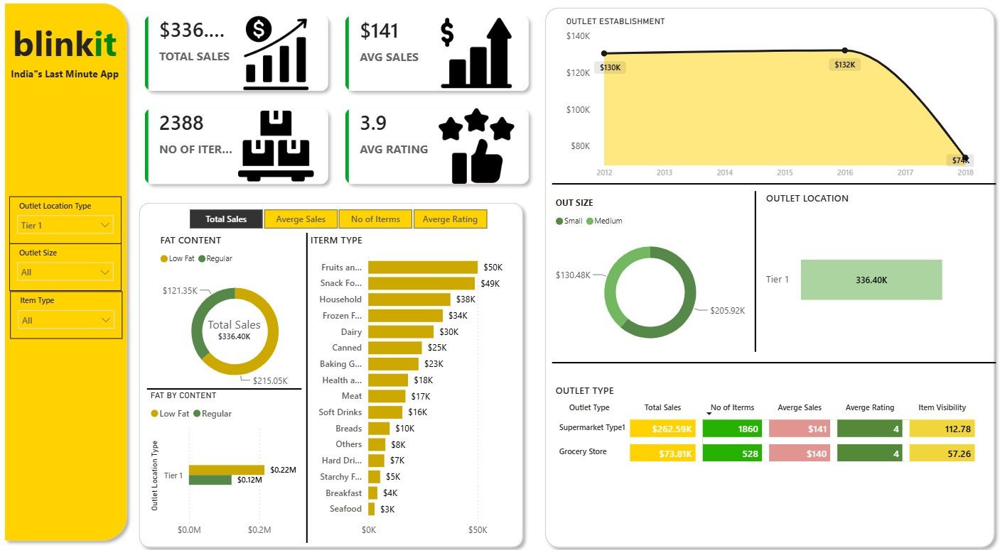

# 🛒 Blinkit Sales Analysis Dashboard | Power BI

## 📌 Project Overview

The Blinkit Sales Analysis Dashboard is an interactive business intelligence project developed using Microsoft Power BI. It focuses on analyzing retail sales performance, outlet characteristics, product categories, and customer purchasing patterns.

The dashboard provides an overview of important business metrics through interactive visualizations and filters, helping users explore sales performance across different outlet types, sizes, and product categories.

## 🎯 Project Objectives

- Analyze overall sales performance and revenue trends.
- Identify top-performing product categories.
- Compare sales across different outlet types and locations.
- Analyze outlet establishment trends.
- Understand the distribution of sales based on fat content.
- Present key business metrics through an interactive dashboard.

## 🛠️ Technologies Used

- Microsoft Power BI
- Power Query
- DAX (Data Analysis Expressions)
- Microsoft Excel
- SQL (if used in the project)

## 📊 Key Performance Indicators (KPIs)

The dashboard highlights the following metrics:

| KPI | Overall Dashboard |
|---|---:|
| Total Sales | $336.40K |
| Average Sales | $141 |
| Number of Items | 2,388 |
| Average Rating | 3.9 |

*Values shown are from the overall dashboard screenshot.*

## 📈 Dashboard Features

- **Sales Analysis:** Displays total sales and average sales performance.
- **Product Analysis:** Compares sales across different item categories.
- **Outlet Analysis:** Evaluates performance across outlet sizes and locations.
- **Fat Content Analysis:** Compares sales distribution between Low Fat and Regular products.
- **Outlet Establishment:** Visualizes sales trends based on outlet establishment year.
- **Interactive Filters:** Allows users to filter data by outlet location type, outlet size, and item type.

## 🖼️ Dashboard Screenshots

### 1. Overall Dashboard

The main dashboard provides an overview of sales KPIs, product categories, outlet performance, and sales distribution.

### 2. Medium Outlet Analysis – Frozen Foods

Dashboard filtered by Medium outlet size and Frozen Foods category.

### 3. Medium Outlet Analysis – Breads

Dashboard filtered by Medium outlet size and Breads category.

## 🎥 Project Demonstration

Watch the complete dashboard demonstration to understand the dashboard layout, interactive filters, and data visualizations.

**[▶ Watch Blinkit Dashboard Demo](YOUR_YOUTUBE_VIDEO_LINK)**

## 📁 Project Structure

Blinkit-Sales-Analysis-PowerBI/
│
├── README.md
├── Screenshots/
│   ├── dashboard-overview.png
│   ├── medium-outlet-analysis.png
│   └── bread-category-analysis.png
│
├── Demo/
│   └── blinkit-dashboard-demo.mp4
│
└── Dashboard/
    └── Blinkit-Dashboard.pbix

## 💡 Key Learnings

- Understanding retail sales data and business KPIs.
- Data cleaning and transformation using Power Query.
- Creating interactive dashboards and visualizations.
- Applying DAX measures for business calculations.
- Analyzing product and outlet-level sales performance.
- Using interactive filters to explore different business scenarios.

## 👨‍💻 Author

**Rushikesh Naik**

Aspiring Data Analyst

- LinkedIn: [LinkedIn Profile](YOUR_LINKEDIN_URL)
- GitHub: [GitHub Profile](YOUR_GITHUB_URL)
